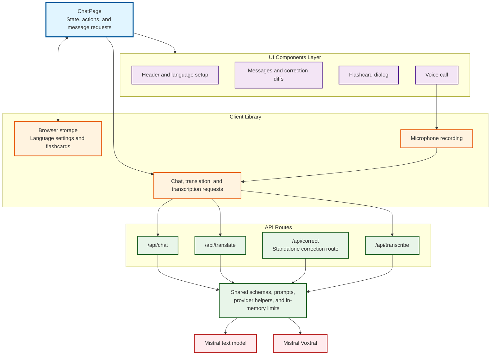
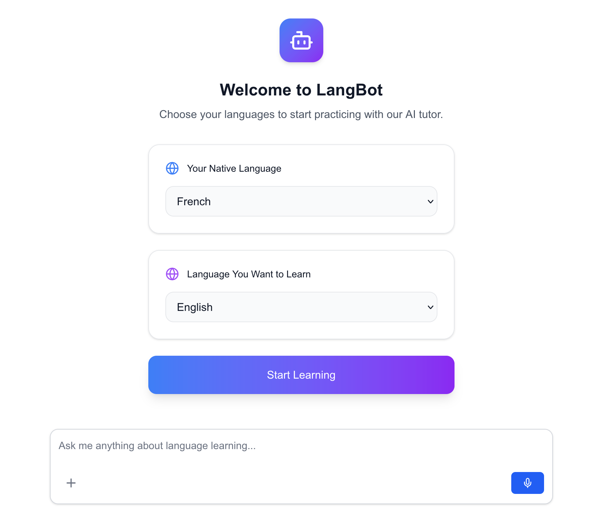
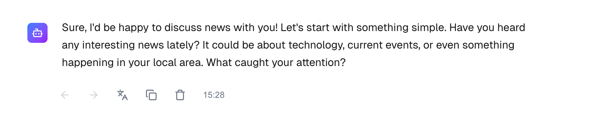
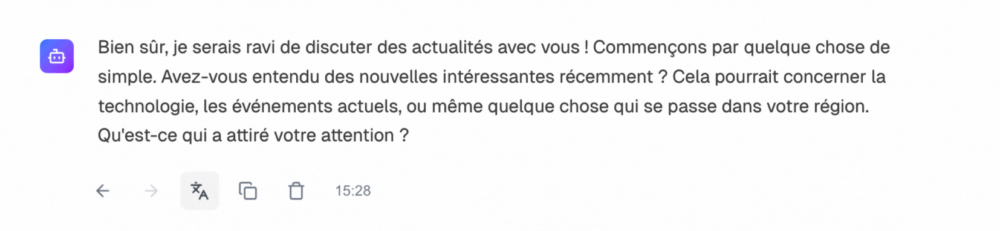
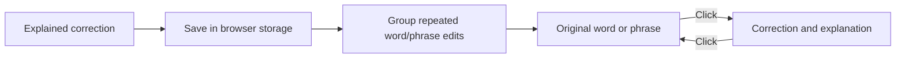
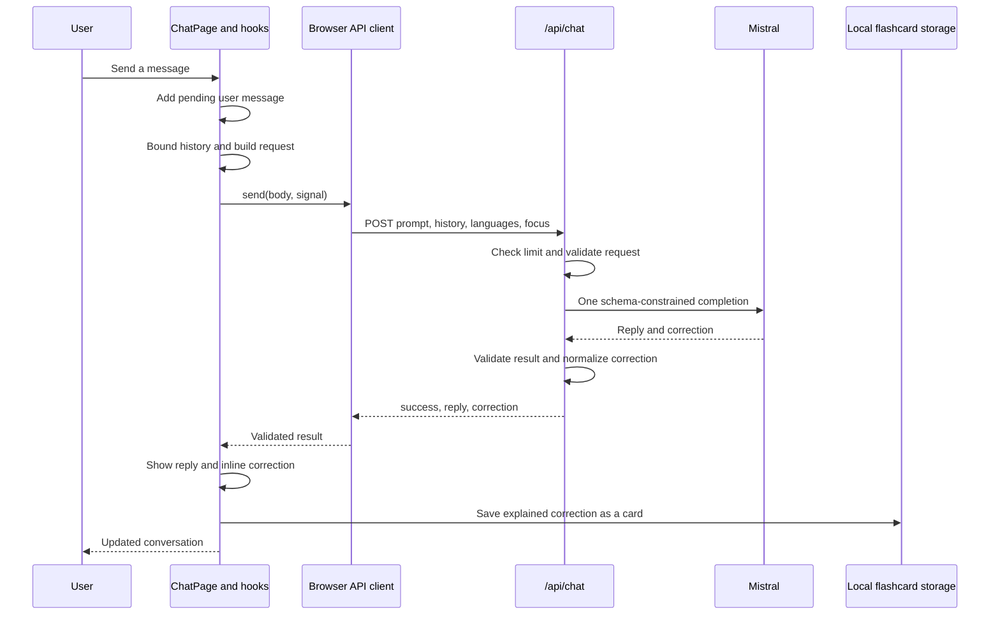
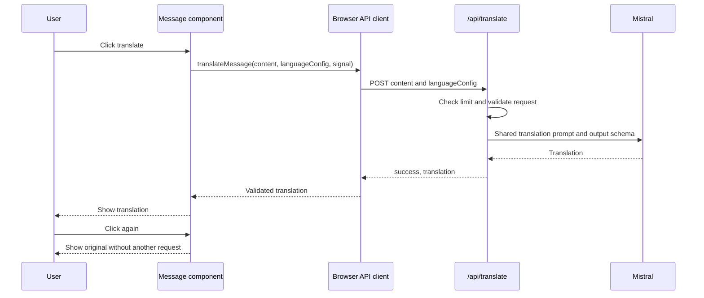
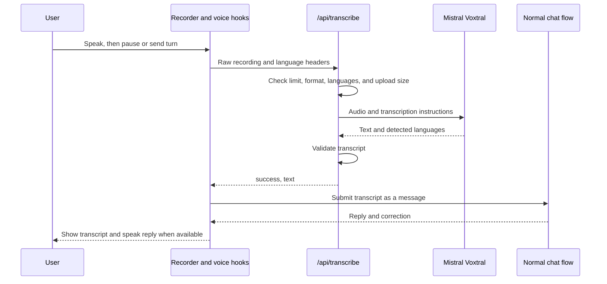

# LangBot

A Next.js-based AI-powered language learning application that helps users practice their target language through natural conversation with an intelligent tutor.

## 🌟 Features

- **Interactive Chat Interface**: Practice through natural conversations with starter suggestions and a compact sidebar showing your selected learning language
- **Multi-language Support**: Choose your native and target languages from 12 supported languages
- **Translation**: Translate replies into your native language and toggle back to the original
- **Inline Corrections**: See grammar, spelling, and punctuation changes inside your message, with explanations in your native language
- **Bilingual Corrections**: Native-language words use the same correction flow to explain their target-language equivalents
- **Flashcards**: Save explained corrections locally, click to flip a card, and browse or remove saved cards
- **Voice Conversations**: Record spoken turns, transcribe them with Mistral Voxtral, and hear replies through browser speech playback
- **Conversation Controls**: Start a new chat, retry failed messages, stop a pending reply, or delete a message and its reply
- **Conversation History**: Send recent messages to the tutor for context; keep language settings and flashcards across reloads

## 🏗️ Architecture

### Tech Stack

- **Framework**: Next.js 15.5.27 (App Router)
- **Language**: TypeScript
- **AI Provider**: Mistral AI; `ministral-8b-latest` for text and `voxtral-small-latest` for transcription by default
- **UI Components**: React 19 with custom components and Lucide icons
- **Styling**: Tailwind CSS 4
- **Validation**: Shared Zod schemas for requests and responses
- **Testing**: Jest and React Testing Library, plus Node tests for the custom lint rule
- **Code Quality**: ESLint, Prettier, Husky, and lint-staged
- **Code Navigation**: A local Graphify graph for coding agents and an interactive architecture view

### Project Structure

```
├── README.md
├── AGENTS.md
├── .agents/skills/graphify/     # Repository-specific agent skill
├── .mcp.json                   # Local Graphify MCP configuration
├── docs/
│   └── graphify.md
├── scripts/
│   └── graphify.mjs            # Pinned Graphify runtime wrapper
├── graphify-out/               # Generated local graph, report, and HTML; Git-ignored
├── __tests__/
│   ├── helpers/
│   ├── integration/            # Mocked chat, correction, translation, transcription, and limits
│   └── unit/                   # UI, cards, provider, voice, and shared helpers
├── tests/
│   ├── fixtures.ts
│   └── lint/
│       └── function-spacing.test.mjs
├── imgs/
├── public/
├── src/
│   ├── app/
│   │   ├── api/
│   │   │   ├── chat/route.ts
│   │   │   ├── correct/route.ts
│   │   │   ├── transcribe/route.ts
│   │   │   └── translate/route.ts
│   │   ├── chat/
│   │   │   ├── ChatPage.tsx
│   │   │   ├── ChatConversation.tsx
│   │   │   ├── useChatState.ts
│   │   │   ├── useChatActions.ts
│   │   │   └── useMessageRequest.ts
│   │   ├── globals.css
│   │   ├── layout.tsx
│   │   └── page.tsx
│   ├── components/ui/
│   │   ├── chat/
│   │   │   ├── header/
│   │   │   ├── input/
│   │   │   ├── message/
│   │   │   └── welcome/
│   │   ├── feedback/           # Error and loading displays
│   │   ├── setup/              # Language selection
│   │   ├── review/
│   │   │   ├── card/
│   │   │   ├── dialog/
│   │   │   └── ReviewToolbar.tsx
│   │   └── voice/
│   │       ├── controls/
│   │       ├── dialog/
│   │       ├── hooks/
│   │       ├── transcript/
│   │       ├── VoiceCall.tsx
│   │       └── voice-call-types.ts
│   └── lib/
│       ├── api/                # Browser requests and response validation
│       ├── chat/               # Conversation history and message helpers
│       ├── config/             # Language settings and request bounds
│       ├── diff/               # Word-level correction differences
│       ├── learning/           # Card schema and browser storage
│       ├── learning.ts         # Build cards from corrections
│       ├── review/             # Card text and repeated-edit grouping
│       ├── schemas/            # Shared runtime contracts
│       ├── server/             # Prompts, provider calls, HTTP helpers, and limits
│       ├── types/
│       └── voice/              # Recording, monitoring, transcription, and cleanup
```



## 🚀 Getting Started

### AI harness setup

This repo includes [Graphify](https://github.com/Graphify-Labs/graphify) agent
guidance, a project skill, and local MCP configuration. With uv and Python 3.10+
installed, coding agents use the graph automatically through `AGENTS.md`.
For a new checkout, agents run `pnpm graphify:setup` and `pnpm graphify:build`
to create the local graph, then `pnpm graphify:update` after source changes.

- `pnpm graphify:check` checks whether the local graph needs refreshing.
- `graphify-out/graph.html` is the interactive architecture view.
- `graphify-out/GRAPH_REPORT.md` is the generated architecture report.
- Queries and ordinary builds use local code extraction without model calls or API credits.
- The runtime cache and generated graph are ignored by Git; each checkout builds its own graph.

See [the Graphify guide](docs/graphify.md) for queries, setup, and MCP configuration.

### Prerequisites

- Node.js 20.18.1 or newer, covering the development dependencies' minimum versions
- pnpm 9
- Mistral AI API key with access to the text model and an audio-capable model for voice calls

### Installation

1. Clone the repository:

```bash
git clone https://github.com/Yvesei/LangBot
cd LangBot
```

2. Install dependencies:

```bash
pnpm install --frozen-lockfile
```

3. Copy the environment example and set your API key:

```bash
cp .env.example .env.local
```

```env
MISTRAL_API_KEY=your_mistral_api_key_here
MISTRAL_MODEL=ministral-8b-latest
MISTRAL_TRANSCRIPTION_MODEL=voxtral-small-latest
```

4. Run the development server:

```bash
pnpm dev
```

5. Open [http://localhost:3000](http://localhost:3000) in your browser.

Development uses `.next-dev`; production builds use `.next` so a build does not overwrite the running development server's files.

## 📖 Usage

### Initial Setup

1. **Select Languages**: Choose your native language and a different target language.
2. **Start Chatting**: Type a message or choose a conversation starter. Send with Enter or the send button; Shift+Enter adds a line.

The language button in the sidebar displays the language you are practising. Click it to change your language pair.



The screenshots and GIFs below show an earlier layout; the current correction display and controls are described here.

### Features Usage

#### Translation

- Translate a tutor reply from the target language into your native language.
- Click again to toggle between the translation and original text.
- Loading and error states are visible; an already loaded translation is reused.




#### Grammar Correction

- The tutor reply and correction arrive together in one AI completion.
- Green additions and red struck-through deletions show changes inside your original message.
- Open **Why these changes?** for explanations, or use **Copy corrected** for the clean sentence.
- Unchanged text has an empty issues array. An unexplained rewrite returns `correction: null`, keeping the original visible with a correction-unavailable notice.


#### Corrections and Flashcards

- Grammar mistakes, spelling mistakes, and native-language words use one correction object with an explanation for each change.
- Explained corrections become flashcards saved in this browser.
- Open **Flashcards** using the stacked-cards icon in the header. Its badge shows the number of grouped cards.
- Click a card to flip between the original word or phrase and its correction or translation with an explanation. Sentence context is shown when needed.
- Use **Previous** and **Next** to browse. Repeated word/phrase corrections appear once, and cards stay separate for each language pair.
- Deleting a message removes its saved cards; **Remove card** removes that grouped correction.
- The latest 100 saved occurrences are kept across reloads and new chats. Review is opened manually.



#### Voice Conversations

- Click the waveform icon beside Send and allow microphone access.
- Speak in either of your selected languages, or mix them when you forget a word.
- Pause or click **Send turn** to finish recording. Each turn is limited to 30 seconds and 2 MiB.
- Mistral Voxtral transcribes the recording; the resulting text follows the same chat, correction, and flashcard flow.
- The call shows an animated status orb, your transcript, and tutor replies. Transcripts appear after each recorded turn.
- Mute the microphone and spoken replies independently. Playback uses available browser/system voices; replies remain readable if playback is unavailable.
- **End voice call** returns to the text conversation and releases the microphone. It cancels pending transcription and playback; an already submitted chat reply can still finish. Use **Stop** in text chat to cancel that reply.
- Use localhost or HTTPS for microphone access. Audio stays in memory and is uploaded to Mistral; LangBot does not save recordings.

#### Conversation Controls

- **New chat** clears conversation history while keeping flashcards and language settings.
- **Stop** cancels the pending chat request; late responses are ignored.
- Retry a failed message without creating another copy of that user message.
- Delete a user message to remove it, its direct reply, and its associated cards.
- Conversation history clears on refresh. Saved settings and cards remain in this browser.

## 🔌 API Endpoints

All endpoints accept POST. Text endpoints require `Content-Type: application/json`. Successful responses use `{ success: true, ... }`; failures use `{ success: false, error }` with an appropriate HTTP status.

Language codes are `en`, `fr`, `es`, `de`, `it`, `pt`, `ru`, `ja`, `ko`, `zh`, `ar`, and `hi`.

### POST `/api/chat`

Main conversation endpoint. The tutor reply, grammar edits, and native-word replacements arrive in one response using the same correction object.

**Request Body:**

```json
{
  "prompt": "I need une cuillère.",
  "history": [],
  "languageConfig": {
    "nativeLanguage": "fr",
    "targetLanguage": "en"
  },
  "learningFocus": []
}
```

`history` and `learningFocus` default to empty arrays. History roles can be `user` or `assistant`; client-supplied `system` messages are rejected. The app can include explanations from up to three recent saved corrections as learning focus.

**Response:**

```json
{
  "success": true,
  "reply": "You need a spoon. What are you making?",
  "correction": {
    "correctedText": "I need a spoon.",
    "issues": [
      {
        "category": "translation",
        "explanation": "Une cuillère se dit a spoon en anglais."
      }
    ]
  }
}
```



### POST `/api/translate`

Translates target-language text into the configured native language.

**Request Body:**

```json
{
  "content": "Bonjour, comment allez-vous?",
  "languageConfig": {
    "targetLanguage": "fr",
    "nativeLanguage": "en"
  }
}
```

**Response:**

```json
{
  "success": true,
  "translation": "Hello, how are you?"
}
```



### POST `/api/correct`

Standalone correction endpoint. The chat UI already receives corrections from `/api/chat`.

**Request Body:**

```json
{
  "content": "I has a appel.",
  "languageConfig": {
    "nativeLanguage": "fr",
    "targetLanguage": "en"
  }
}
```

**Response:**

```json
{
  "success": true,
  "correction": {
    "correctedText": "I have an apple.",
    "issues": [
      {
        "category": "grammar",
        "explanation": "Avec « I », on utilise « have »."
      },
      {
        "category": "spelling",
        "explanation": "Le mot s'écrit « apple »."
      },
      {
        "category": "grammar",
        "explanation": "On utilise « an » devant « apple »."
      }
    ]
  }
}
```

Both chat and standalone corrections contain `correctedText` and an `issues` array. Categories are `grammar`, `spelling`, `punctuation`, or `translation`. Unchanged text has no issues; unexplained rewrites return `correction: null`.

### POST `/api/transcribe`

Transcribes raw Ogg, WebM, or MP4 audio using both selected languages. This endpoint expects audio bytes, not JSON or a multipart form.

**Request:**

```http
POST /api/transcribe
Content-Type: audio/webm
X-Native-Language: fr
X-Target-Language: en

<raw WebM audio bytes>
```

**Response:**

```json
{
  "success": true,
  "text": "I need une cuillère."
}
```

Transcription preserves the spoken wording and language switches. The chat step handles corrections afterward. Empty or unintelligible audio and speech reported in an unselected language return a visible error.



## 🎯 AI Tutor Behavior

The AI tutor is designed to:

- **Encourage Expression**: Continue natural conversation and explain corrections in the learner's native language
- **Preserve Meaning**: Fix demonstrable errors and clear native-word gaps while preserving valid wording, tone, names, and formatting
- **Maintain Context**: Use bounded recent history and saved correction explanations for useful follow-up practice
- **Stay Engaging**: Ask a relevant follow-up question
- **Be Patient**: Support practice without grading the learner

Corrections and transcripts are model-generated suggestions; the app does not guarantee linguistic accuracy.

## 🔧 Configuration

### Environment Variables

- `MISTRAL_API_KEY`: Server-only provider key; never exposed to the browser
- `MISTRAL_MODEL`: Text model, defaulting to `ministral-8b-latest`
- `MISTRAL_TRANSCRIPTION_MODEL`: Audio model, defaulting to `voxtral-small-latest`

### Language Configuration

Select languages through the UI. The supported pair is validated before settings are saved in browser storage.

```typescript
import { saveLanguageConfigToStorage } from '@/lib/config/language';

saveLanguageConfigToStorage({ nativeLanguage: 'en', targetLanguage: 'fr' });
```

### Conversation Context

Recent completed messages and the selected languages are included in chat requests. Pending or failed turns are excluded from history. The browser trims history to fit the server's character and byte limits.

```typescript
import type { ChatRequest } from '@/lib/schemas';

const request: ChatRequest = {
  prompt: 'Bonjour !',
  history: [
    { role: 'user', content: 'Salut !' },
    { role: 'assistant', content: 'Bonjour ! Comment vas-tu ?' },
  ],
  languageConfig: { nativeLanguage: 'en', targetLanguage: 'fr' },
  learningFocus: [],
};
```

### Request Limits and Storage

- **Five requests per minute** across all API routes, configured in [limits.ts](src/lib/server/limits.ts)
- Separate counters per client IP on Vercel; a shared counter on other hosts or without Vercel's client IP header
- Counters live in server memory, reset on process restart, and are separate on each server instance
- Voice turns normally use two requests: transcription and chat; translation also consumes the allowance
- Flashcards and language settings use browser storage; chat history lives in memory
- Cards stay in the current browser, without accounts or cross-device synchronization

## 🔐 Security

- API keys stay on the server in environment variables
- Zod validates request fields, language values, history roles, and provider output
- JSON bodies are limited to 32 KiB with a five-second read deadline; audio bodies are limited to 2 MiB
- Unknown request fields and client-supplied system messages are rejected
- Requests with a different Origin are rejected; shared route helpers enforce usage limits
- Learner text is separated from system instructions and rendered as React text, not raw HTML
- Trimming normalizes input; prompt instructions reduce unwanted behavior but do not guarantee protection from prompt injection
- Error responses hide internal details; logs record operational metadata without chat content or API keys

## 📊 Performance Considerations

- **Message History Limit**: Up to 12 messages, with 20,000 combined prompt/history characters
- **Chat Input Limit**: 2,000 characters; history is also trimmed to the 32 KiB JSON request budget
- **AI Calls**: Reply and correction share one non-streaming completion per chat message
- **Max Output Tokens**: Text completions default to 2,200 tokens; transcription allows 1,200
- **Temperature**: 0 for schema-constrained text and transcription responses
- **Provider Deadline**: 25 seconds; text calls can retry once for selected temporary errors when the retry delay fits the two-second wait limit
- **Voice Limits**: 30 seconds and 2 MiB per recorded turn
- **Translation Cache**: Toggling an already loaded translation does not make another request

## 🧪 Testing

Application tests are organized into **unit** and **integration** groups. The custom lint rule has separate Node tests.

```
__tests__/
├── helpers/api.ts
├── integration/
│   ├── chat.test.ts
│   ├── correct.test.ts
│   ├── limits.test.ts
│   ├── transcribe.test.ts
│   └── translate.test.ts
└── unit/
    ├── api-client.test.ts
    ├── learning.test.ts
    ├── limits.test.ts
    ├── page.test.tsx
    ├── provider.test.ts
    ├── recorded-recognition.test.ts
    ├── refactor-characterization.test.ts
    ├── review.test.ts
    └── voice-call.test.tsx
tests/
└── lint/function-spacing.test.mjs
```

### 🧩 Test Structure

- **Unit tests** cover UI interactions, correction diffs, card persistence and grouping, request handling, provider failures, and recording cleanup.
- **Integration tests** call API route handlers with mocked Mistral responses, including limits and transcription. They do not start a server or spend API credits.
- **Lint rule tests** check blank-line detection and fixes for functions, methods, tests, and setup blocks.
- Browser and provider mocks do not test physical microphones, installed speech voices, or live model quality.

### 🚀 Running Tests

Commands are defined in `package.json`:

- `pnpm test` — Run all Jest tests
- `pnpm test:unit` — Run unit tests
- `pnpm test:integration` — Run mocked API integration tests
- `pnpm test:coverage` — Generate a coverage report
- `pnpm test:lint` — Test the custom spacing rule
- `pnpm lint` — Check ESLint rules
- `pnpm typecheck` — Check TypeScript types
- `pnpm build` — Build the production application

### ✅ Example Usage

To run all integration tests:

```bash
pnpm test:integration
```

To run a specific test file:

```bash
pnpm test __tests__/integration/chat.test.ts
```

### 🧹 Linting and Formatting

Installing dependencies enables the Husky pre-commit hook. It fixes staged JavaScript/TypeScript with ESLint, formats them with Prettier, then checks ESLint again. Other supported staged files are formatted with Prettier. Remaining lint errors block the commit.

- Keep blank lines between functions, tests, and setup/cleanup blocks.
- Code allows 250 lines per file and 100 per function; Jest tests allow 400 and 150.
- Blank lines and comment-only lines do not count toward those limits.
- Functions accept at most four parameters; nesting is limited to two levels and complexity to ten.
- Application code uses explicit braces, one statement per line, and no nested ternaries.
- Generated files and the dependency lockfile are excluded from Prettier.

See [eslint.config.mjs](eslint.config.mjs) and [.prettierrc.json](.prettierrc.json) for the full configuration. Run `pnpm lint:staged` to apply the same staged-file checks manually.

## CI/CD Pipeline

GitHub Actions runs checks. Vercel's Git integration handles deployments separately.

### Workflow Overview

**On Pull Requests targeting main:**

- Install dependencies from the lockfile
- Run ESLint, TypeScript, and the spacing-rule tests
- Run unit and mocked integration tests
- Build the application
- Vercel provides a preview deployment link and status

**On Main Branch (after merge):**

- Run the same validation workflow
- Vercel deploys production through its Git integration

### Required Secrets

Set `MISTRAL_API_KEY` in the Vercel project's preview and production environment settings. Set the optional text and transcription model variables there if you want to override their defaults.

The GitHub Actions workflow uses mocked provider responses and does not require Mistral or Vercel deployment secrets.

## 🗺️ Roadmap

- [x] Unit and mocked API integration tests
- [x] CI checks and Vercel deployment integration
- [x] Input validation and structured response parsing
- [x] Inline corrections with native-language explanations
- [x] Simple local flashcards
- [x] Recorded voice input and spoken replies
- [x] Linting, formatting, and pre-commit checks
- [x] Local Graphify navigation for coding agents
- [ ] User authentication
