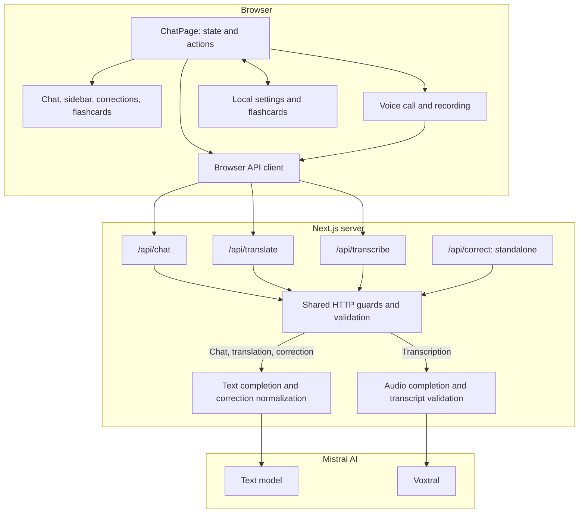
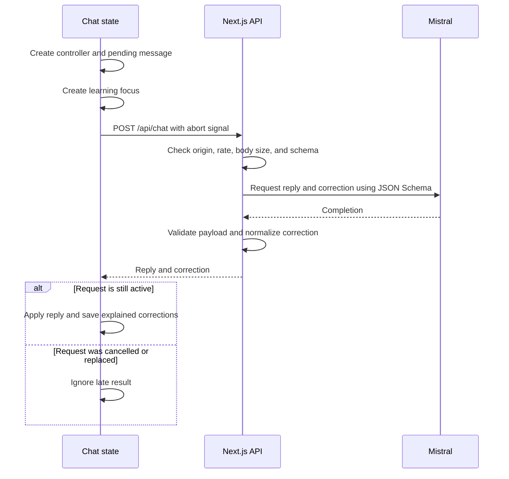
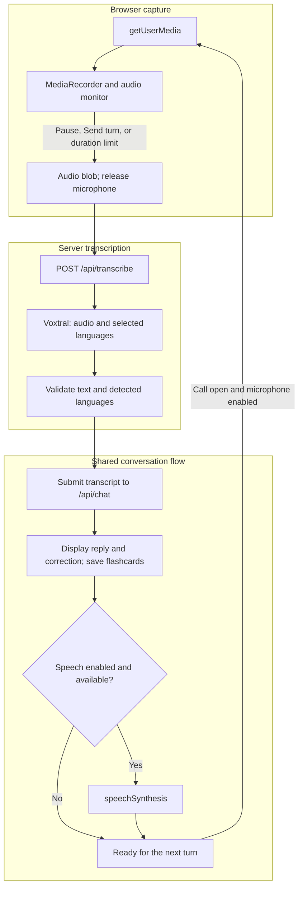
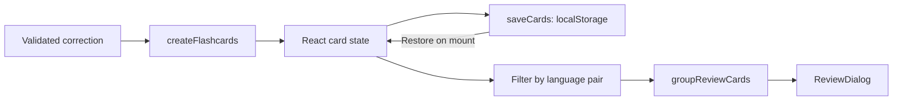
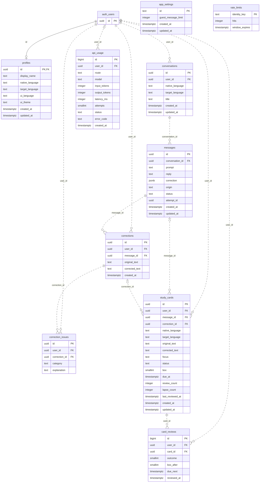

<p align="center">
  <a href="https://chat.ouchta.com">
    
  </a>
</p>

<h1 align="center">Languify</h1>

<p align="center">A full-stack language tutor built with Next.js, TypeScript, and Mistral AI.</p>

<p align="center">
  <a href="https://chat.ouchta.com"><strong>chat.ouchta.com</strong></a>
  · <a href="#implementation">Implementation</a>
  · <a href="#architecture">Architecture</a>
  · <a href="#run-locally">Run locally</a>
</p>

## Features

- **12 languages:** conversational practice, mixed-language input, and translation.
- **Corrections:** word-level diffs and native-language explanations from the chat response.
- **Flashcards:** persistent correction history, grouped by phrase and language pair.
- **Voice:** browser recording → Voxtral transcription → shared chat pipeline → speech playback.
- **UI:** two themes, responsive navigation, cancellation, retry, and message deletion.

## Tech stack

| Frontend                    | Backend & AI       | Quality & delivery           |
| --------------------------- | ------------------ | ---------------------------- |
| Next.js 15 · React 19       | Next.js API routes | Jest · React Testing Library |
| TypeScript · Tailwind CSS 4 | Mistral · Voxtral  | ESLint · Prettier · Husky    |
| MediaRecorder · Web Audio   | Zod · JSON Schema  | GitHub Actions · Vercel      |

## Architecture

### Project structure

```text
src/
├── app/
│   ├── api/                 # Chat, correction, translation, transcription
│   └── chat/                # Page, conversation state, and request hooks
├── components/ui/
│   ├── brand/               # Theme-specific logos
│   ├── chat/                # Sidebar, messages, input, and welcome screen
│   ├── setup/               # Language selection
│   ├── review/              # Flashcards and review dialog
│   └── voice/               # Call controls, transcript, and lifecycle hooks
└── lib/
    ├── api/                 # Browser requests and response validation
    ├── chat/                # Conversation history and request construction
    ├── learning/            # Card schema and browser storage
    ├── review/              # Grouping and review helpers
    ├── schemas/             # Shared request and response contracts
    ├── server/              # Prompts, provider calls, limits, and HTTP helpers
    └── voice/               # Recording, monitoring, and transcription
tests/
├── unit/                    # UI, state, storage, provider, and voice
├── integration/             # API routes with mocked model responses
├── lint/                    # Custom ESLint rule tests
├── helpers/                 # Shared test utilities
└── fixtures.ts              # Shared test data and response builders
```

### Application flow



## Implementation

| Concern              | Implementation                                                                                                                                                                         |
| -------------------- | -------------------------------------------------------------------------------------------------------------------------------------------------------------------------------------- |
| Model output         | Zod → JSON Schema with `strict: true`; validate the completion envelope and parsed payload before returning it. [Provider parsing](src/lib/server/mistral-response.ts)                 |
| Correction semantics | Reply and correction share one completion. Unexplained rewrites become `correction: null`; unchanged text returns an empty issues array. [Normalization](src/lib/server/correction.ts) |
| Async state          | An `AbortController` identifies the active request. Stale results are ignored; retries reuse the message ID. [Request hook](src/app/chat/message/useMessageRequest.ts)                 |
| Provider failures    | 25-second deadline; text requests retry once on `429`, `502`, `503`, or `504` if the retry delay fits a 2-second budget. [Retry logic](src/lib/server/mistral-request.ts)              |
| Context assembly     | Read completed messages for the active conversation, trim them by count and size, and include up to three saved correction explanations. [Chat route](src/app/api/chat/route.ts)       |
| Audio lifecycle      | `MediaRecorder` format negotiation, Web Audio silence detection, generation checks, and track/timer cleanup. [Voice modules](src/lib/voice)                                            |
| Observability        | Structured completion logs include model, latency, usage, and attempts; API errors include request IDs and status. [Provider metrics](src/lib/server/mistral.ts)                       |

### Chat request lifecycle



### API contract

All routes use the Node.js runtime. Text requests use `application/json`; transcription accepts raw audio bytes.

| POST endpoint     | Input                                                                  | Result fields         |
| ----------------- | ---------------------------------------------------------------------- | --------------------- |
| `/api/chat`       | `conversationId`, `messageId`, `prompt`, `languageConfig`, `learningFocus`, `origin` | `reply`, `correction` |
| `/api/correct`    | `content`, `languageConfig`                                            | `correction`          |
| `/api/translate`  | `content`, `languageConfig`                                            | `translation`         |
| `/api/transcribe` | Ogg/WebM/MP4 body; `X-Native-Language` and `X-Target-Language` headers | `text`                |

Example chat request:

```json
{
  "conversationId": "29f01f5a-14de-4a98-829e-fdc680f2beb0",
  "messageId": "7207ee80-801c-4e25-b8a9-04020135080b",
  "prompt": "I need une cuillère.",
  "languageConfig": { "nativeLanguage": "fr", "targetLanguage": "en" },
  "learningFocus": [],
  "origin": "text"
}
```

- **Success:** `{ "success": true, ...result }`.
- **Failure:** `{ "success": false, "error": "..." }` with an HTTP error status.
- **Correction:** `{ correctedText, issues: [{ category, explanation }] }` or `null` when unavailable.
- **Response headers:** guarded routes set `X-Request-ID` and `Cache-Control: no-store`; rate-limit errors can include `Retry-After`.
- **Validation:** strict request schemas, server-owned conversation context, and two distinct supported languages.

[Request and response schemas](src/lib/schemas) · [Route wrapper](src/lib/server/http.ts) · [Response helpers](src/lib/server/http/responses.ts)

### Request limits

| Boundary             | Limit                                                          |
| -------------------- | -------------------------------------------------------------- |
| Chat prompt          | 2,000 characters                                               |
| Conversation context | 12 stored messages; 20,000 combined prompt/context characters  |
| JSON request         | 32 KiB; 5-second body-read deadline                            |
| Audio                | 2 MiB upload; 30-second browser recording limit                |
| Provider call        | 25 seconds, combined with caller cancellation                  |
| API rate             | 5 requests/minute across routes per resolved client identity   |

Body limits are enforced during stream reads, including without `Content-Length`. Requests with a different `Origin` are rejected. Rate counters are in-memory per server instance; a voice turn normally uses two requests.

### Voice pipeline



Closing a call aborts recording and transcription, cancels playback, and clears audio resources. An already-submitted chat request can still finish in the text conversation.

### State and persistence

| Data                    | Storage                                                     | Lifecycle                                                 |
| ----------------------- | ----------------------------------------------------------- | --------------------------------------------------------- |
| Conversation            | Supabase `conversations` and `messages`                     | Restored after reload; new chats stay separate            |
| Language pair and theme | Supabase `profiles`                                         | Restored for the current anonymous or Google account      |
| Flashcards              | Schema-validated `localStorage`                             | Latest 100 occurrences; no account or cross-device sync   |



Cards retain their `sourceMessageId`; deleting a turn removes its associated cards. Review groups retain occurrence IDs so removing a group deletes all its occurrences.

### Database schema

`app_settings`, `profiles`, `conversations`, and `messages` back the current settings and chat flow. The remaining tables describe planned learning persistence. `auth_users` represents Supabase's `auth.users`; the other tables belong to `public`.

| Setting                   | Storage                                  | Database column                    |
| ------------------------- | ---------------------------------------- | ---------------------------------- |
| Preferred native language | Anonymous or Google account profile      | `profiles.native_language`         |
| Preferred target language | Anonymous or Google account profile      | `profiles.target_language`         |
| Theme                     | Anonymous or Google account profile      | `profiles.ui_theme`                |
| Guest message allowance   | Counted from saved messages               | `app_settings.guest_message_limit` |

The app restores preferences through `GET /api/settings` and saves changes through `PATCH /api/settings`. Profile language preferences stay empty until setup is completed. Drafts, dialogs, and active voice-call state remain in React.

`app_settings.guest_message_limit` defaults to five messages before sign-in. The guest's consumed-message count is derived from saved messages; it is separate from the per-minute API rate limit.

UUID IDs and numeric identity IDs are generated on insert. `profiles.id` uses the existing Auth user ID, and `rate_limits.identity_key` is supplied by the server. Creation timestamps and initial `updated_at` values default to `now()`; subsequent updates must set `updated_at` in application code.



## Testing & delivery

```bash
pnpm test              # All Jest tests
pnpm test:unit         # Unit and UI tests
pnpm test:integration  # Mocked API route tests
pnpm test:lint         # Custom ESLint rule tests
pnpm test:coverage     # Jest coverage report
pnpm test:watch        # Rerun Jest tests as files change
```

Run a specific test file:

```bash
pnpm test tests/unit/page.test.tsx
```

Additional checks:

```bash
pnpm lint              # ESLint
pnpm typecheck         # TypeScript
pnpm build             # Production build
```

| Tests          | Scenarios                                                                       |
| -------------- | ------------------------------------------------------------------------------- |
| Chat & review  | Cancellation, late responses, retries, saved cards, language isolation          |
| Voice          | Permission failures, missing playback, mixed-language input, microphone cleanup |
| Provider & API | Malformed output, retry limits, validation, shared rate limits                  |
| Lint tooling   | Custom rule detection and automatic fixes                                       |

- **CI:** lint → typecheck → unit + integration + lint-rule tests → production build.
- **Pre-commit:** ESLint and Prettier through Husky and lint-staged.
- **Deployment:** Vercel previews and production through Git integration.
- **Test isolation:** mocked model responses; no API credits required.

[Browse tests](tests) · [CI workflow](.github/workflows/test.yml) · [Custom lint rule](eslint-function-spacing.mjs)

## Run locally

**Requires:** Node.js 22 and pnpm 12 — corepack picks up the pinned version from the `packageManager` field. The Supabase SDK requires Node.js 22 or later. `pnpm-workspace.yaml` approves the native dependency install scripts used by the app so fresh installs can run non-interactively in CI and Docker.

```bash
git clone https://github.com/Yvesei/LangBot.git languify
cd languify
pnpm install --frozen-lockfile
cp .env.example .env.local
```

Set `.env.local` (`MISTRAL_API_KEY` and the Supabase variables are required; model variables override the defaults):

```env
MISTRAL_API_KEY=your_mistral_api_key_here
MISTRAL_MODEL=ministral-8b-latest
MISTRAL_TRANSCRIPTION_MODEL=voxtral-small-latest
NEXT_PUBLIC_SUPABASE_URL=
NEXT_PUBLIC_SUPABASE_ANON_KEY=
```

### Production database migrations

Merges to `main` apply pending Supabase migrations through GitHub Actions. Configure the repository's `production` environment with:

| GitHub value                   | Where to find it                                                                                    |
| ------------------------------ | --------------------------------------------------------------------------------------------------- |
| Secret `SUPABASE_ACCESS_TOKEN` | Supabase **Account → Access Tokens**                                                                |
| Secret `SUPABASE_DB_PASSWORD`  | Project **Settings → Database**; this is the same database password often named `POSTGRES_PASSWORD` |
| Variable `SUPABASE_PROJECT_ID` | Project **Settings → General → Reference ID**                                                       |

```bash
pnpm dev
```

Open [localhost:3000](http://localhost:3000). Voice recording requires localhost or HTTPS. Development output uses `.next-dev`; production builds use `.next`.

### Docker

Requires Docker with Compose. Create `.env.local` from `.env.example` and set your Mistral API key, then:

```bash
docker compose --env-file .env.local up --build -d
docker compose logs -f app
docker compose down
```

`--env-file` also feeds the Supabase build args; without it auth compiles out and the container still runs guest-mode.

Open [localhost:3000](http://localhost:3000). Mistral credentials are loaded at runtime; the public Supabase URL/key are passed as build args. `.env` files are excluded from the build context.

The multi-stage image uses [Next.js standalone output](https://nextjs.org/docs/app/api-reference/config/next-config-js/output) and runs as a non-root user.

[Graphify setup and code navigation](docs/graphify.md)
