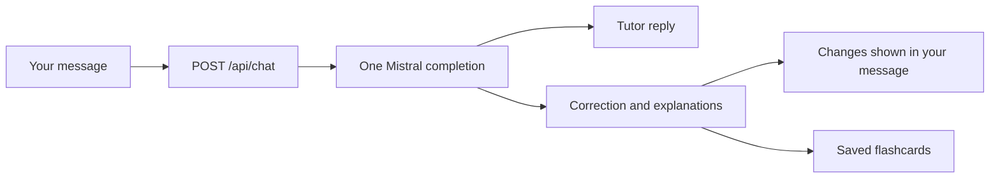
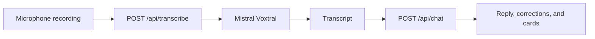

# LangBot

A language-learning chat app built with Next.js 15.5.27, React 19, TypeScript, and Mistral.

## Chat and corrections

Choose your native language, target language, and level, then send a message. The tutor replies in your target language and returns corrections in the same AI response.

Corrections appear inside your message as green additions and red struck-through deletions. Open **Why these changes?** for explanations in your native language, or use **Copy corrected** to copy the sentence. You can also translate replies, retry failed messages, and stop a pending reply.

The same correction object handles grammar, spelling, and native-language words you use when you do not know their target-language equivalent. For example, a French speaker learning English can write “I need une cuillère.” and receive “I need a spoon.” with a translation explanation. Valid wording and the learner's meaning should stay intact. These are model-generated suggestions, so errors are still possible.



## Flashcards

Click **Flashcards** above the conversation to open your saved cards.

- The front shows the incorrect or native-language word or phrase. When sentence context is needed, it shows the sentence.
- Click the card to flip it and see the corrected text and explanation.
- Use **Previous** and **Next** to browse, or **Remove card** to forget it.
- Repeated word/phrase corrections appear as one card.

Cards use the same corrections as chat. They are stored in this browser, separated by language pair, with the latest 100 saved occurrences kept across reloads. **New chat** clears the conversation and keeps cards. Deleting a message also removes its reply and associated cards. Conversation history itself clears on refresh.

## Voice calls

Click the waveform icon beside Send and allow microphone access. Speak, then pause or click **Send turn**. The app records your turn, sends it to Mistral Voxtral for transcription, and submits the resulting text to the same chat flow.

You can mix your two selected languages. Transcription keeps the spoken words; the chat correction handles any missing target-language words afterward. Turns stop after a pause or 30 seconds. Audio uploads are limited to 2 MiB.



The call screen shows the transcript and replies. You can mute the microphone and spoken replies independently. Closing the call releases the microphone and cancels pending transcription and playback. A chat reply already submitted can finish in the text conversation; use **Stop** there to cancel it.

Microphone access requires localhost or HTTPS. Audio stays in memory until it is uploaded to Mistral; LangBot does not save recordings. Spoken replies use available browser/system voices. You can still read replies if speech playback is unavailable.

## Local setup

Requires Node.js 20.18.1 or newer and pnpm 9. This covers the development tools' minimum Node versions.

```sh
pnpm install --frozen-lockfile
cp .env.example .env.local
# Set MISTRAL_API_KEY in .env.local.
pnpm dev
```

Open http://localhost:3000.

Environment variables:

- `MISTRAL_API_KEY`: your server-side Mistral key.
- `MISTRAL_MODEL`: text model; defaults to `ministral-8b-latest`.
- `MISTRAL_TRANSCRIPTION_MODEL`: audio model; defaults to `voxtral-small-latest`. Your key needs access to an audio-capable model.

For Vercel previews and production, set these variables in the Vercel project. GitHub Actions runs checks; Vercel's Git integration handles deployments.

Development uses `.next-dev`, while production builds use `.next`, so building does not overwrite a running development server's files.

## API

All endpoints use POST and return `{ success: true, ... }` on success or `{ success: false, error }` on failure.

- `/api/chat`: JSON with `prompt`, `history`, `languageConfig`, `userLevel`, and optional `learningFocus`. Returns `reply` and `correction`.
- `/api/correct`: JSON with `content`, `languageConfig`, and `userLevel`. Returns `correction`. This standalone route remains available; the chat UI gets corrections from `/api/chat`.
- `/api/translate`: JSON with `content` and `languageConfig`. Returns `translation`.
- `/api/transcribe`: raw Ogg, WebM, or MP4 audio. Set its `Content-Type`, `X-Native-Language`, and `X-Target-Language` headers. Returns `text`.

Example chat request:

```json
{
  "prompt": "I has a apple.",
  "history": [],
  "languageConfig": { "nativeLanguage": "fr", "targetLanguage": "en" },
  "userLevel": "beginner"
}
```

Example response:

```json
{
  "success": true,
  "reply": "What kind of apple do you like?",
  "correction": {
    "correctedText": "I have an apple.",
    "issues": [
      { "category": "grammar", "explanation": "Avec « I », on utilise « have »." },
      { "category": "grammar", "explanation": "On utilise « an » devant « apple »." }
    ]
  }
}
```

If a sentence is unchanged, its correction has no issues. If the model rewrites it without an explanation, the server returns `correction: null` and keeps the reply.

## Request limits

The app uses an in-memory counter allowing **five requests per minute across all API routes**, configured in [limits.ts](src/lib/server/limits.ts).

On Vercel, each client IP has a separate counter. Other hosts and requests without Vercel's client IP header share one counter. Counters reset when the process restarts, and each server instance has its own counters. A voice turn normally uses two requests: transcription and chat. Translation also uses the allowance.

JSON bodies are limited to 32 KiB, chat messages to 2,000 characters, and history to 12 messages and 20,000 combined characters. Text and transcription calls have a 25-second provider deadline. Text calls can retry once for selected temporary provider errors.

## Code map

- `src/app/chat/`: page composition, chat state, actions, and message requests.
- `src/components/ui/chat/`: `header/`, `input/`, `message/`, and `welcome/` components.
- `src/components/ui/review/`: flashcard `card/` and `dialog/` components plus the toolbar.
- `src/components/ui/voice/`: the call entry point plus `dialog/`, `controls/`, `transcript/`, and `hooks/`.
- `src/components/ui/setup/` and `feedback/`: language selection, empty state, errors, and loading.
- `src/lib/api/`: browser requests and response validation.
- `src/lib/chat/`: conversation history and message helpers.
- `src/lib/learning.ts` and `src/lib/review/`: saved cards, displayed text, and grouping.
- `src/lib/voice/`: recording, silence monitoring, transcription uploads, and cleanup.
- `src/lib/server/`: shared prompts, provider calls, correction normalization, HTTP helpers, and limits. `transcription.ts` contains request building, the provider call, and result validation.
- `src/lib/schemas/`: runtime validation shared by the server and client.

## Checks and formatting

```sh
pnpm lint
pnpm typecheck
pnpm test
pnpm test:lint
pnpm build
```

Use `pnpm test:unit` or `pnpm test:integration` for one group, and `pnpm test:coverage` for coverage. Integration tests call route handlers with mocked Mistral responses. They do not make paid API calls. CI runs lint, types, spacing-rule tests, unit tests, integration tests, and the build.

Installing dependencies enables the Husky pre-commit hook. It runs ESLint fixes and Prettier on staged files, then checks ESLint again. Remaining lint errors block the commit. Run it manually with `pnpm lint:staged`.

Keep blank lines between functions, tests, and test setup blocks. Code limits are 250 lines per file and 100 per function; Jest tests allow 400 and 150. Blank lines and comments do not count. The full rules live in [eslint.config.mjs](eslint.config.mjs).

There are no accounts or cross-device card synchronization. Automated tests use browser and provider mocks; they do not establish live speech quality or model accuracy.

See [the cleanup decisions](REFACTOR_REPORT.md), [the completed plan](REFACTOR_PLAN.md), and [the lint rules](LINT_REPORT.md) for development context.
