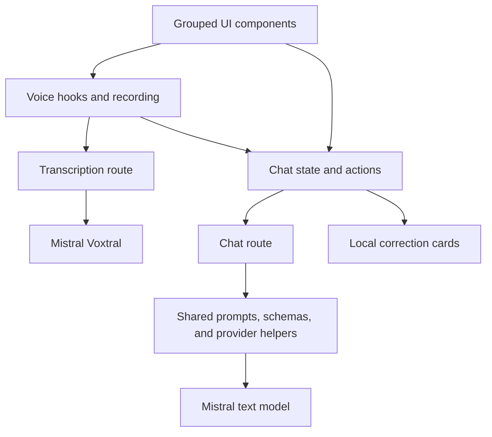

# Cleanup decisions

Updated for the reviewed application after PRs #2–#8.

## Chat and corrections

The chat route now returns a tutor reply and correction together, so sending a message does not require a separate correction request. Shared schemas check requests and responses, while server helpers handle provider errors, timeouts, and request limits.

Grammar mistakes and native-language word gaps use the same correction object and explanations. The UI displays changes inside the original message and saves those corrections as flashcards.

Practice exercises, topic tracking, and separate vocabulary objects were removed during review.

## Simple flashcards

Cards show the mistaken or native-language word/phrase on the front and the corrected text plus explanation on the back. The learner clicks to flip, browses manually, and can remove a card.

Repeated word/phrase corrections are grouped. Cards persist in the current browser and are separated by language pair. Scheduling, self-grading, automatic review opening, and the end-session control were removed.

## Folders and related functions

UI components are grouped by purpose, including chat headers, inputs, messages, review cards/dialogs, and voice controls/transcripts. Related small functions stay together to keep the number of files manageable.

Chat state and actions remain in five files under `src/app/chat/`. The voice library keeps recording, monitoring, transcription, recognition, and message helpers in six files.

Server transcription request building, the Mistral call, and result validation now share `src/lib/server/transcription.ts`. Voice controls share `useVoiceActions.ts`; recognition handlers sit beside session setup and cleanup in `useRecognitionSession.ts`.

## Limits and deployment

Redis was removed. The in-memory limiter allows five requests per minute across API routes, with separate client IP counters on Vercel and a shared fallback elsewhere.

GitHub Actions validates the project. Vercel's Git integration handles previews and production deployments. Development and production builds use separate output folders.

## Verification

The merged tooling work was validated with 160 application tests across 17 Jest suites and 26 spacing-rule tests, plus lint, types, formatting, and the production build.

Those checks used mocked providers and browser APIs. They did not spend Mistral credits or test physical microphone hardware. The evaluation PR was skipped.

PR #9 changes documentation only. Its checks cover Markdown formatting, local links, example payloads, and confirmation that application and tooling files match main. Previous coverage percentages and historical audit counts are omitted because they describe a different implementation.
